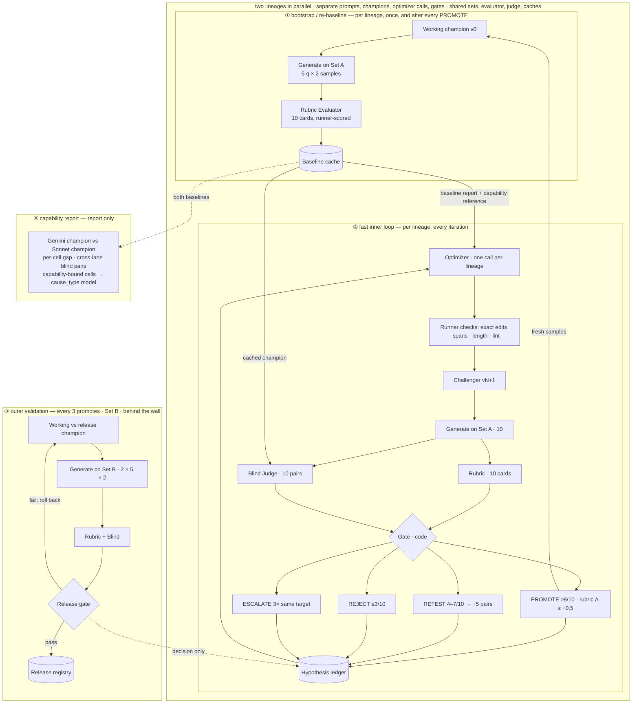

# Owlry Evo-Prompt v4.2 — orchestration package

> Installed in this repository: see [IMPLEMENTATION.md](IMPLEMENTATION.md) for the run commands (the runner is `evolve/v4/runner/evo4.ts`), what was fixed on install, the test suites, and what to decide before the first run. This README is the design as delivered.

Three AI roles and a deterministic runner. Two worker lineages (Gemini, Sonnet) are evolved in parallel: separate prompts, champions, baselines, optimizer calls and gates; the same Set A, Set B, rubric evaluator and blind judge. The runner also produces a capability report from the two champions, which is how the model gap is measured, and never a gate input.

`COMPARISON.md` says what this version takes from the two v4.1 packages and why. The loop diagram is published as the artifact "Evo-Prompt v4.1 Loop" (updated for v4.2).

```
evo-v4.2/
  README.md                 this file: steps, gate numbers, who sees what, data layout, tests, implementation order
  COMPARISON.md             the two v4.1 packages side by side, with the simulated gate numbers
  config.v4.2.json          sets, lanes, lineages, agents, gate, promotion, validation, capability, stop, lint, protected parts
  sets/setA.json            fast-evolution set: 5 questions with type, intent, curated topic words
  runner-only/setB.json     validation set (texts live only here; no optimizer input builder reads this folder)
  prompts/castDebate.{gemini,sonnet}.v0.md   champions: the original prompt (Gemini + basis plumbing)
  prompts/castDebate.{gemini,sonnet}.v2.md   the round-12 evolved prompts, entered as the first manual challengers
  seeds/protected-spans.json   byte-exact spans every challenger must keep (tools/make_spans.py regenerates it)
  roles/optimizer.md · rubric-evaluator.md · blind-judge.md · dispatcher.md · worker-envelope.md · envelope-note.txt
  schemas/*.schema.json     strict output schemas for optimizer, rubric, blind judge, worker (JSON Schema 2020-12)
  rubric-map.json           the 35 cells with their maxima; the runner computes every point from it
  runner/                   evo4.ts (CLI skeleton) + tested modules: gate, scoring, edits, spans, challenger, lint, metrics, cache, state, inputs, capability
  tests/run.ts              41 tests (npx tsx tests/run.ts · deno run -A tests/run.ts); tsc -p tsconfig.json type-checks the package
  tools/gate_stats.py · gate_stats2.py · make_spans.py
```

## 1. The loop in one paragraph

Bootstrap each lineage: generate its champion on Set A (5 questions × 2 samples), score the ten transcripts with the rubric evaluator, cache them as the baseline. Then iterate: the optimizer reads the baseline and writes one challenger with one hypothesis; the runner validates the proposal (exact edits, protected spans, length, topicality lint); the challenger is generated on the same ten slots; the evaluator scores its ten transcripts; the blind judge compares the ten pairs with the slot order randomized; the gate decides PROMOTE, RETEST, REJECT or KEEP, and the escalation counter may turn a non-promotion into ESCALATE. A promotion re-baselines the new champion with fresh samples. Every third promotion triggers a validation on Set B against the release champion. The two lineages do all of this side by side; `evo4 capability` compares their champions.



## 2. Migration from schema 2 and from the v4.1 packages

Keep: the schema-2 Gemini client, worker framing and question bank (wired through `runner/legacy.ts`). Replace: `master.md` → `roles/dispatcher.md`; `editor.*.md` → `roles/optimizer.md`; `judge.v2.md` → `roles/rubric-evaluator.md` + `roles/blind-judge.md`; `config.json` → `config.v4.2.json`. From the v4.1 prompt package, the schemas and `rubric-map.json` are used directly (patched to 4.2.0; see COMPARISON §2). Nothing from rounds 1–12 is a baseline: the evaluator, the Gemini temperature and the basis rule changed; historical scores are `methodology=legacy`.

## 3. Step 0 — plumbing and champion selection (about 2 hours of wall time per lineage)

1. Copy the package into `evolve/v4/`. Fill `runner/legacy.ts` (three functions). `npx tsx tests/run.ts` → 41 passed; `tsc -p tsconfig.json` → clean.
2. Prune `sets/setA.json` `topicWords` once by eye. Fill `runner-only/setB.json` `pool` with any further held-out ids.
3. Give the optimizer, evaluator and judge agents a filesystem scope limited to their `promptPath` and `outPath`; the runner-only folder and `<lineage>/validations/` must be unreachable. A wall is enforced by scope, not by wording.
4. `evo4 bootstrap` (both lineages) → `evo4 next` → dispatcher batch (Sonnet 10 generations, Opus 20 cards) while `gemini-batch` runs in the background → `evo4 ingest`. Both baselines exist; `evo4 capability` writes the first capability report (the model gap under the new evaluator).
5. Champion selection by the gate: `evo4 challenge --lineage sonnet --file prompts/castDebate.sonnet.v2.md --note "control: round-12 evolved prompt vs original"`, same for gemini, then `evo4 next` / `ingest` to the decision. (As installed: enter both right after `evo4 bootstrap`; each is queued and tested as soon as its baseline closes, and a relative `--file` is resolved against `evolve/v4/`.) Prediction from the logs: Sonnet REJECT, Gemini KEEP or REJECT. Whatever the gate says is the champion; nothing is assumed from version numbers.

## 4. One inner iteration (both lineages at once; Gemini ≈ 15 min, Sonnet ≈ 20 min wall time)

| step | state | command / job | the agent reads | the agent returns |
|---|---|---|---|---|
| 6 | OPTIMIZING | `evo4 next` → 1 optimizer job per lineage | its lineage's champion prompt, protected spans, Set A, all champion transcripts with cards and form metrics, cells by points lost, recurring symptoms, capability reference (numbers), ledger, bans, budget | `propose` (kind, hypothesis with cause_type and targets, evidence, exact edits, full candidate), `no_change` or `escalate` |
| 6b | LINTING | `evo4 ingest` | — | the runner rejects: wrong parent, edits that do not reproduce the candidate, a broken protected span, over the ceiling or the 10% growth, a topic word or category conditional, the user section, an ablation that adds text. The problems are appended to the input and the job respawned once; twice → the iteration closes as KEEP |
| 7 | GENERATING | `evo4 next` → 10 generations per lineage (challenger only) | challenger system prompt + question + envelope note | the debate JSON |
| 8 | EVALUATING | `evo4 next` → 10 rubric jobs per lineage | brief + situation + type + worker note + deterministic checks + one debate | 35 ratings with evidence, symptoms, mechanical patterns, findings with statuses; no totals |
| 9 | COMPARING | `evo4 next` → 10 blind jobs per lineage | brief + situation + type + debate A + debate B (champion slot by hash, per pair) | winner, margin, paired comparisons with locations, best of each, concerns |
| 10 | DECIDING | `evo4 ingest` runs the gate | — | PROMOTE / RETEST / REJECT / KEEP; escalation check → ESCALATE |
| 11 | PROMOTED → REBASELINING, else → OPTIMIZING | `evo4 next` | the ledger line is written first | next iteration |

The dispatcher repeats `next → spawn → ingest` until both lineages print STOPPED, NEEDS_HUMAN or ERROR. `NEEDS_HUMAN` appears when the working pointer no longer matches the parent a challenger was tested against (compare-and-swap failed), when a baseline lost more than half its slots after redraws, or when Set B has been used `maxUsesBeforeRefresh` times.

### Who sees what

| | champion prompt | challenger prompt | version / lineage | Set A transcripts | rubric cards | blind verdicts | other lineage | Set B |
|---|---|---|---|---|---|---|---|---|
| Optimizer | its own | writes it | its own | its own | its own (symptoms, no prescriptions) | tallies via the ledger | cell means only | never |
| Rubric Evaluator | no | no | no | one debate at a time | writes one | no | no | one debate at a time, in a validation |
| Blind Judge | no | no | no | one pair at a time | no | writes one | only in a cross-lane capability pair, unlabelled | one pair at a time, in a validation |
| Dispatcher | paths only | paths only | job ids only | no | no | no | job ids only | no |

Enforced by `buildRubricInput` / `buildBlindInput` (tested to contain no version, lane, score or "newer" word), by the folder split (`runner-only/`, `<lineage>/validations/`), and by the agent scope rule in step 0.3.

## 5. Gate numbers

Shared latent-quality model (per-sample rubric sd 3.11; blind votes correlated with latent quality; 18% ties), 100k runs, `tools/gate_stats2.py`:

| rule | false promote | detects +2 | detects +3 | detects +4 | calls / iteration |
|---|---|---|---|---|---|
| v4.1 package: 5 pairs, ≥4 question wins and mean Δ ≥ 1, targeted retest | 9.2% | 45% | 67% | 84% | 22 |
| **v4.2: 10 pairs ≥8 (else +5 → ≥11), rubric Δ ≥ +0.5, regression guard** | **3.5%** | **47%** | **77%** | **94%** | **47** |

Consequences written into the briefs: a challenger carries one change worth +3 or more; the blind tally decides; the rubric must agree in direction and may not fall materially (mean −0.5, any criterion −5% of its max); a blind win with a contradicting rubric is RETEST then KEEP. Critical failures reject regardless of wins: an invalid transcript, a basis with chapter/section/page/link from a non-browsing worker, more than one pd=false turn with quotation marks, a critical safety finding, a provisional (truncated) card. An incomplete panel (a judge output missing after two attempts) keeps the champion and is not a loss.

## 6. Escalation, stop rules, baseline refresh

- ESCALATE: a non-promotion closes the third consecutive attempt on the same target cell → the cell is banned for 5 iterations and listed in the optimizer's input; the optimizer can also escalate itself (`action: escalate`) with a `cause_type` and a `next_system_action`, which the runner logs to `<lineage>/escalations.log`.
- STOP (per session): 30 iterations, 600 calls, 6 consecutive non-promotions, 2 consecutive escalations.
- Baseline refresh: a champion that has been compared 5 times against the same cached bundle is redrawn before the next optimizer call (their rule), in addition to the redraw on every promotion (mine).

## 7. Outer validation (Set B)

Trigger: 3 promotions since the last validation, or `evo4 validate`. The comparator is the release champion, or before any release the `initialReleaseReference` (the production prompt, v0); a version is never validated against itself. Both versions × 5 Set B questions × 2 samples, 10 cards each, 10 blind pairs with the working champion in the challenger role. PASS (≥ 7/10 and rubric Δ ≥ 0) → release := working, one Set B question rotates out; FAIL (≤ 3/10, or rubric Δ < −1, or a critical failure) → working := release, re-baseline; INCONCLUSIVE → +1 sample per question, PASS at ≥ 10/15, else the working champion stays experimental and nothing is released. Only the decision line crosses into `<lineage>/validations.log`.

## 8. Capability report

`evo4 capability` reads both baselines (same Set A, same evaluator version) and writes `capability/<time>.md`: total, per-question and per-criterion gaps, and all 35 cells with the gap, whether it holds on every question, and whether it is capability-bound (≥ 2.0 rating points on every question). `--blind` adds 10 cross-lane judge jobs (Gemini champion sample s vs Sonnet champion sample s, slot randomized) whose verdicts are tallied into the report. The trailing lineage's optimizer receives the cell means as CAPABILITY REFERENCE and treats capability-bound cells as `cause_type: model`. Run it after bootstrap and after every promotion; it is the capability measure the old milestones (70 / 90) were trying to be.

## 9. Overfitting safeguards, in order of strength

1. Topicality lint on every challenger (curated words per Set A question, category names, category conditionals; words already in the champion are never hits).
2. Re-baseline on promote, and refresh after 5 comparisons.
3. Set B validation every 3 promotions with rollback; Set B rotates one question per PASS and is refreshed after 3 uses.
4. Per-category deltas and question-level wins in every ledger line.
5. Canary test (section 11, #9): a unique token planted in every Set B text, output, card and verdict must never appear in any optimizer input.

## 10. Data layout and cache keys

```
evolve/v4/cache/gen/<key>.json      key = sha256(lineage, lane, promptHash, model, settings{…, draw: experiment id}, questionId, questionText, envelopeVersion, sample)
evolve/v4/cache/rubric/<key>.json   key = sha256(transcriptHash, rubricVersion, model, effort, questionType, canBrowse)   value = { raw, card }
evolve/v4/cache/blind/<key>.json    key = sha256(aHash, bHash, judgeVersion, model, effort)   order is part of the key
evolve/v4/<lineage>/versions/vN.md, vN.json · champion.json · baseline.json · ledger.jsonl · bans.json · escalations.log · validations.log · calls.count
evolve/v4/<lineage>/experiments/<id>/state.json, jobs/, out/, pairs.json, missing.log, contaminated.log
evolve/v4/<lineage>/validations/<id>/…      evolve/v4/capability/<time>.md, latest.json
```

Any change to a brief, a schema version, a model, an effort, the temperature, the envelope or a question text changes the keys and starts a new baseline by construction. Every transition is saved before the next job is emitted; on restart `evo4 next` re-emits only jobs whose outputs are missing; raw agent outputs are preserved next to the parsed ones.

## 11. The 18 fixtures from the v4.1 package, where each lives in v4.2

| # | requirement | where |
|---|---|---|
| 1 | bootstrap saves outputs and cards before the first optimizer request; no blind call | `state.ts`: OPTIMIZING reachable only via `baseline_done`; `emitOptimizer` throws without `baseline.json` |
| 2 | rejected, tied, incomplete and exhausted challengers leave the working pointer unchanged | `decide` tests (KEEP on incomplete, contradictory evidence); `runGate` never writes `champion.json` |
| 3 | a gate-passing challenger updates the pointer atomically | `afterPromote`: compare-and-swap on the tested parent, else NEEDS_HUMAN |
| 4 | no inner-loop outcome updates the release pointer | only `runValidationGate` writes `champion.release` |
| 5 | blind payload has no ids or scores; mapping unblinds correctly | `buildBlindInput` test; `championSlot` determinism test |
| 6 | a deletion passes when it reproduces the candidate and keeps spans; a rewrite cannot bypass limits | `edits.ts`, `spans.ts`, `challenger.ts` tests |
| 7 | repeated failed hypotheses stop or escalate | `escalation` test; `stopReason` test |
| 8 | a verified source error blocks promotion; an unverified concern is not relabelled | `scoring.ts`: cap only on observed / supported findings (test); `criticalCheck` on observed facts only |
| 9 | Set B canary never reaches the optimizer | integration test to add: plant a token in `runner-only/setB.json`, run a validation with mocks, grep every `jobs/optimizer.md` |
| 10 | separate champions, configurations and caches per lineage | per-lineage directories; `Lineage` class |
| 11 | crash after saved outputs resumes without regeneration | cache-hit check in every emitter; `state.json` saved before emission |
| 12 | changing the evaluator invalidates cards, changing generation settings invalidates samples | cache-key tests |
| 13 | two samples of one question still weigh one fifth | `questionTally` test; balanced retest (+1 per question) |
| 14 | failed validation preserves the release and rolls back the working champion | `releaseDecide` test; `runValidationGate` |
| 15 | malformed agent JSON gets one repair; a malformed worker answer stays a recorded failure | `retire()`; validity stored with every transcript |
| 16 | budget reservation | `calls.count` + `stopReason`; reservation before dispatch is the coding agent's addition |
| 17 | a contaminated A/B response, truncated card or missing question cannot pass the gate | `contaminated()`, `provisional` critical, incomplete → KEEP |
| 18 | neutral evidence ids; no judge opinion copied into evidence | no evidence adapter in this configuration; `deterministicChecks` carry facts only |

## 12. Implementation sequence (coding agent)

1. Wire `legacy.ts`; run tests and tsc. (1 hour)
2. Bootstrap + caching for both lineages; `gemini-batch`; `capability`. (half a day)
3. Inner loop: optimizer job, proposal validation, generation, rubric with runner scoring, blind, gate, ledger, re-baseline, refresh. (one day)
4. Mock-model integration tests for PROMOTE, RETEST→KEEP, REJECT, ESCALATE, no_change, escalate, incomplete; the Set B canary. (half a day)
5. Outer validation, release registry, rotation. (half a day)
6. Dispatcher run of step 0 (both lineages) and the two control challenges; report the first capability report. (two sessions of wall time)

## 13. First experiments

1. Control, both lineages: original v0 vs the round-12 v2 (`evo4 challenge`). This settles whether twelve rounds of edits did anything, under the new evaluator, with 10 pairs.
2. First capability report after bootstrap: the gap by cell under rubric-evaluator-4.2.0, and the list of capability-bound cells for Gemini.
3. Three optimizer iterations per lineage, then validation; report release champion vs v0 on Set B per lineage. That report, not the Set A trajectory, is the progress line.
